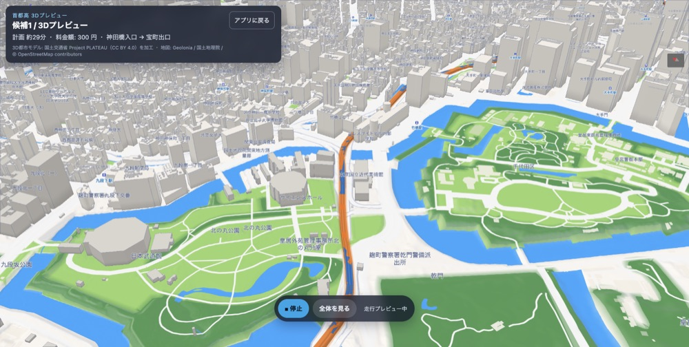

# MachGL 先行版の3Dプレビュー

2026-10-30 に、候補カードから開く3Dプレビューを先行実装した。正式版の MachGL は 2026-11-09 の提供開始予定で、この実装は Geolonia が公開している MachGL デモのバンドルをビルド時に取得して動かす暫定版である。正式版が出たら取得元を差し替え、デモ由来の資産を捨てる。

調査の経緯と判断は [MachGL でルートプレビューを3D化できるか](machgl-route-preview.md) にまとめている。

## 何を出したか

候補カードの「3Dで見る」を押すと、別タブで `/machgl-preview/` が開く。地図は MachGL のデモと同じ3D建物・地形・空を使い、選択中の候補の周回線、課金対象の1区間、出発地・入口・出口を重ねる。開いた直後は周回全体を俯瞰し、デスクトップでは約1.4秒後に走行プレビューが始まる。小さい画面では自動再生せず、下部の「走行プレビュー」から始める。

- 周回線は濃い青の太線に白い芯と水色の霞を重ねる。`return` と `access` は灰色の破線、`return_corridor` と `exit_approach` は青の破線にする。
- 課金対象の1区間はオレンジの破線で示す。線の下に幅18pxの霞を敷く。
- 全線に `fill-extrusion` の低い立体リボン（幅12m、高さ8m）を付ける。地面に貼った線だけでは、ピッチ55度以上で建物に隠れる区間があるためだ。
- 出発地・入口・出口は circle レイヤーで置く。入口・出口の座標はルートの区間端からの近似で、公式なランプ位置ではない。
- ヘッダーに候補番号、計画時間、料金、入口→出口、PLATEAU と地図の出典を出す。「アプリに戻る」は同じタブを `/` へ戻す。



## 構成

```
web/index.html                     # 候補カードの外側。3DボタンはJSで追加する
web/src/map/machgl-preview.ts      # ペイロード作成、localStorage 保存、別タブ起動
web/machgl-preview/bridge.js       # プレビュー側。ルート描画、カメラ、再生操作
web/machgl-preview/bridge.css      # プレビューのヘッダーと操作ボタンの見た目
scripts/prepare-machgl-preview.mjs # デモの取得、バンドル加工、キー差し替え
web/public/machgl-preview/         # ビルド時の生成物（git 管理外）
```

親アプリは MachGL をバンドルしない。候補から作った JSON を `localStorage` の `machgl-preview:<id>` に置き、`/machgl-preview/#<id>` を新しいタブで開くだけである。プレビュー側は起動時にハッシュを読み、項目を削除してから描画する。タブを閉じても本体の地図と検索結果は残る。

初回ロードの予算を守るため、3D の取得は候補選択後まで遅らせている。通常 UI のメインバンドルは約 62KB gzip で、以前の 60KB から 2KB ほど増えただけである。プレビュー側はデモのバンドル約 465KB とスタイル約 111KB を別タブで読む。

## ビルドとキー

`web` の `predev` / `prebuild` が `scripts/prepare-machgl-preview.mjs` を実行し、次の処理をする。

1. `https://geolonia.github.io/machgl-demo/` の HTML からバンドルのパスを拾う。
2. バンドルの `new <Map>({container:"map"` を `window.__machglMap=new <Map>({container:"map"` に置換し、`hash` 連携を切る。
3. デモ HTML からインライン script を外し、インライン `<style>` を `preview.css` へ出す。UI を隠す CSS、`bridge.js`、`bridge.css` を足す。
4. `style-color.json` と `style-monotone.json` の `YOUR-API-KEY` を `GEOLONIA_API_KEY` に差し替える。
5. `config.json` に `enabled` と取得元を書く。取得に失敗したら `enabled: false` にしてビルドは続ける。

キーはビルド環境の `GEOLONIA_API_KEY` から読む。リポジトリには書かない。未設定ならデモキー `YOUR-API-KEY` で生成し、`config.json` の `key` を `demo` にする。本番では Workers Builds の環境変数に実キーを入れる。

```
cd web
GEOLONIA_API_KEY=... npm run build
```

生成物は `/web/public/machgl-preview/` に置かれ、`web/dist/machgl-preview/` へコピーされる。`.gitignore` で除外しているので、clone 直後は `npm run build` か `npm run dev` の prebuild で生成する。

アプリは起動時に `/machgl-preview/config.json` を読み、`enabled: true` かつ WebGL2 が使えるときだけ「3Dで見る」を出す。生成に失敗したビルドや WebGL2 非対応端末では、従来の Leaflet 地図だけを見せる。

## CSP とデータの扱い

CSP は全アセットで1つにした。`web/public/_headers` の `/*` と `index.html` の meta に、3Dプレビューのタイル先を足す。

- `connect-src` に `tileserver.geolonia.com`、`api.geolonia.com`、`cdn.geolonia.com`、`glyphs.geolonia.com`、PLATEAU の `d23l04mwnd60ho.cloudfront.net`、DEM の `stars.optgeo.org` を足す。
- `img-src` に同じスプライトの配信元と `blob:` を足す。
- `script-src` は `'self'` のまま。バンドルとブリッジは同一オリジンから配る。デモ HTML のインライン script はビルド時に外す。
- `style-src` は `'self'` のまま。デモ HTML のインライン `<style>` は `preview.css` へ、ブリッジのスタイルは `bridge.css` へ外部化する。
- `worker-src 'self' blob:` は既にある。MachGL は Blob ワーカーを作る。

経路ごとの CSP は使わない。Cloudflare の `_headers` は `/*` と `/machgl-preview/*` の両方を適用し、同じヘッダーが重複するとブラウザは CSP の積集合を課す。`/machgl-preview/*` だけ `connect-src` を緩めても、`/*` の `connect-src 'self'` が残ってタイルが止まる（`cf dev` で確認した）。そのため、全体の CSP にタイル先を足し、スクリプトとスタイルの制限は変えない形にした。

`web/public/_headers` の `/*` と `index.html` の meta の一致は `workers/test/security-headers.test.ts` が検査する。同テストで、`connect-src` と `img-src` にプレビューのタイル先が入り、`script-src` が `'self'` のままであることも確認する。

帰属はプレビューのヘッダーと、アプリのフッターに出す。Geolonia、国土地理院、OpenStreetMap contributors、国土交通省 Project PLATEAU（CC BY 4.0、加工）である。プライバシー面では、「3Dで見る」を押したときだけ表示範囲（出発地点を含む）が Geolonia の地図タイルへ送られることを、地図の注記とフッターに書いた。通常の地図は従来どおり国土地理院のタイルだけを使う。

## 制約と次にやること

- デモのバンドルは正式版ではない。API が変わる可能性があり、ライセンス条件も正式版の条項で確認する必要がある。2026-11-09 以降に公式 CDN の URL と使い方へ差し替える。
- プレビューは東京都心の PLATEAU を前提にしている。23区外のルートでは3D建物が出ない可能性がある。ルート線と地形は出る。
- モバイル実機の性能は未計測。デモは WebGL2 と GPU メモリを使う。30fps を下回る端末では、自動再生を止めるか、リボンを外す調整が要る。
- 入口・出口のマーカーはルート区間端の近似で、正確なランプ位置ではない。カードの文言を正とし、地図は位置関係の把握に使う。
- デモキーでビルドした場合は、本番の表示回数や利用条件がデモの範囲に収まらないおそれがある。Workers Builds に実キーを設定する。
- 正式版への差し替え時は、`scripts/prepare-machgl-preview.mjs` の取得元を公式 CDN にし、`bridge.js` の `waitForMap` から `window.__machglMap` の露出依存を外す。`web/public/machgl-preview/` のデモ資産は削除する。

## テスト

- `web/test/machgl-preview.test.ts`: legacy と radial の候補から、区間・課金区間・出発地・入口・出口・サマリーを作る純粋関数の検証。
- `web/e2e/product-ui.spec.ts` の (76): 候補カードから3Dボタンを押し、新しいタブの `/machgl-preview/` が候補1のヘッダーを出すことを検証する。Geolonia のタイル要求は abort し、CI のネットワークに依存させない。
- `workers/test/security-headers.test.ts`: 全体の CSP にプレビューのタイル先が入り、`script-src` が `'self'` のままであることを検証する。
