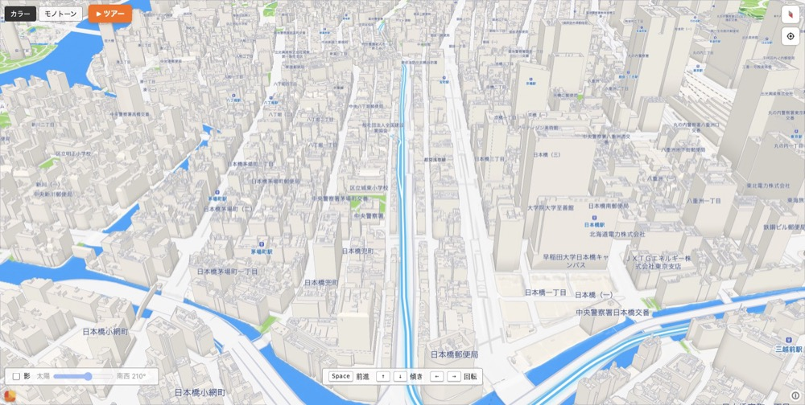
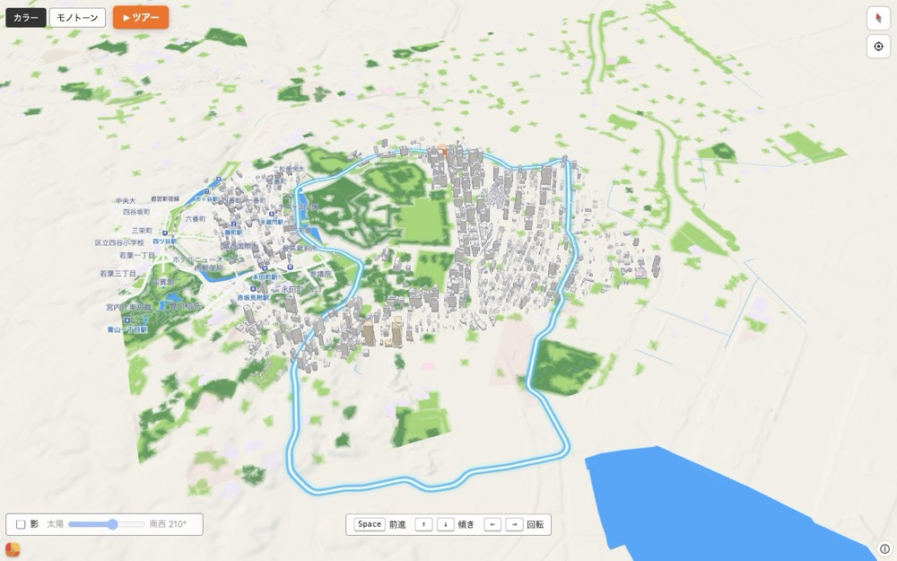
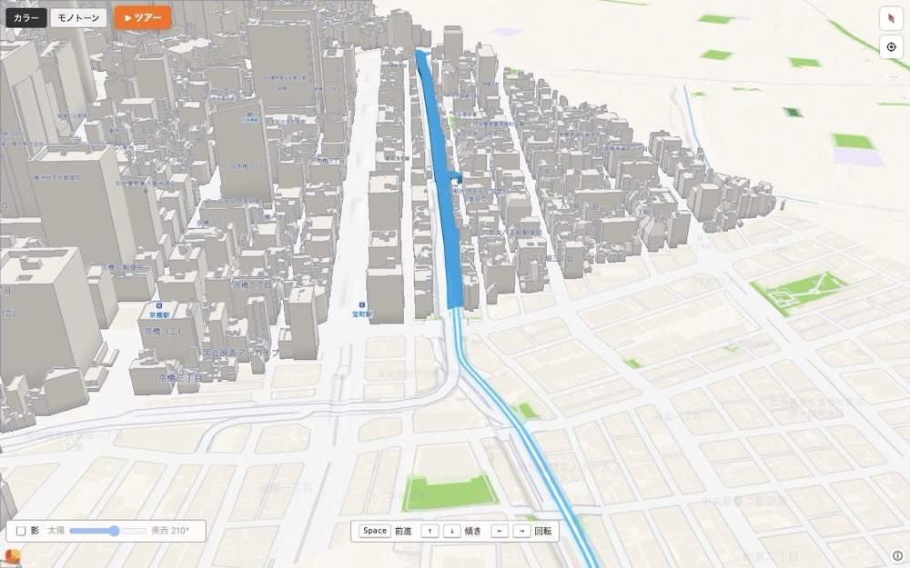

# MachGL でルートプレビューを3D化できるか

調査日: 2026-10-30。対象は [INTERNET Watch の記事](https://internet.watch.impress.co.jp/docs/column/chizu3/2151651.html)、[Geolonia のリリース告知](https://www.geolonia.com/news/2026-10-21-machgl-release/)、[MachGL デモ](https://geolonia.github.io/machgl-demo/)。

> 2026-10-30 追記: 正式版前の先行リリースとして、デモのバンドルをビルド時に取得する3Dプレビューを実装した。実装と撤去手順は [machgl-preview.md](machgl-preview.md) にある。以下の結論は、正式版の配布物を前提にした調査時点の判断である。

## 結論

**技術的には十分に可能。ただし、今日そのまま本番へ出す状態ではない。** 正式提供は 2026-11-09 で、2026-10-30 時点ではデモ以外の配布物がない。npm パッケージ、CDN の URL、API ドキュメント、ライセンス条項のいずれも確認できず、3D 表示には Geolonia Maps の API キーとベクタータイルが要る。

推奨は、**既存の Leaflet 地図を残したまま、候補カードから開く「3Dプレビュー」をオプトインで追加する**形にする。初回ロードの 8 秒予算に触れず、WebGL2 が使えない端末では従来の 2D 地図にそのまま戻せる。正式版が出た 11 月 9 日以降に 1〜2 日のスパイクで見極め、下の合格条件を満たせば製品化する。

*デモをローカルに複製し、実ルート（678点・16.1km）を重ねて撮影。ズーム16、ピッチ58度。*

## 判断に効く数字

| 項目 | 値 | 出所 |
| --- | --- | --- |
| MachGL 本体 | 約 98KB gzip | Geolonia のリリース告知 |
| デモのアプリ全体 | 465KB raw / 192KB gzip | 実測（デモのバンドル） |
| 現在の Web のメインバンドル | 60.0KB gzip（うち Leaflet 42.4KB） | 実測（`web/dist`） |
| 検証に使った実ルート | 678点 / 16.1km / 計画 28.6分 | 実 WASM + `graph.json` |
| デモの静止時 | 60.7fps（M4 / Chromium 155） | 実測（2秒計測） |
| 初回ロード予算 | 8,000ms に対し p95 7,495ms（余裕 505ms） | `docs/delivery.md` |
| Geolonia Maps | Free 20,000表示/月、Pro 3,980円/50,000表示 | [料金ページ](https://www.geolonia.com/pricing/) |

## 調査方法と限界

デモをローカルへ複製し、地図インスタンスを `window` に露出させる 1 行の改変を加えて、API と描画を実測した。製品コードへの取り込みはしていない。デモの style JSON とタイル URL を読み、ソース種別・レイヤー種別・未対応プロパティを洗った。ルートはリポジトリの `dist/wasm` と `fixtures/generated/graph.json`（`all-real-v5`）で東京駅近傍（35.6896727, 139.7644248）から 15〜60 分の探索を実行し、得た候補を GeoJSON として重ねた。

画面は 1280×800 と 1470×741、Chromium 155、Apple M4（ANGLE Metal）。モバイル実機、回線スロットル、iOS Safari は未検証である。デモのバンドルは正式版のライブラリではなく、API は変わり得る。以下の実測値は「デモでどこまで出せるか」の上限として読んでほしい。

## デモで確認できたこと

### 3D の見た目と操作感は目標に届く

建物の立体表示、地形、空と霞、ドラッグ・回転・傾けはデモの時点で完成している。東京都心の建物は PLATEAU の LOD1 が中心で、窓や庇まで描く LOD2/LOD3 も同じレイヤーで扱える（リリース告知による）。色はカラーとモノトーンの2種類があり、ルート線を青系で置くと背景のグレーから素直に浮く。

カメラは `easeTo`、`flyTo`、`fitBounds`、`jumpTo` があり、デモのツアーは `easeTo` を連続させて東京タワーや都庁へ飛ぶ。ルートに沿ったフライトも同じ仕組みで作れる。実測では、ズーム16・ピッチ58度でルート線を追いながら、日本橋の街路を抜ける映像が得られた。停止時のフレームレートは 60.7fps、`getStats().frameMs` は 2.5〜6.9ms だった。

*ズーム13.2、ピッチ45度。周回の形と課金区間の位置を一度に見せる。*

### GeoJSON のルートはそのまま描ける

`geojson` ソースと `line` レイヤーで、678点の LineString を3枚重ねた（外側の霞、中間の色、白い芯）。線の色・太さ・不透明度・ぼかしは style の指定どおりに反映された。`line-dasharray` はデモの style でも使われており、警告も出ていない。区間ごとの色分けは、区間を別フィーチャーに分けて `setPaintProperty` で切り替えればよい。

### 線は地面に貼られ、高いピッチでは建物に隠れる

line レイヤーに標高を上げる指定はない。`line-elevation` も `line-z-offset` も未対応で、ルート線は地形の高さに沿って地面へ描かれる。首都高の高架そのものの高さには乗らない。ピッチを 55 度以上にすると、街路の両側の建物が線の手前に来て、区間によっては見えなくなる。日本橋のような街路の谷では線が通るのが分かるが、建物が密な区間では途切れて見える。

対策は2つある。カメラのピッチを 45 度前後に抑えるか、`fill-extrusion` の立体リボンで線を持ち上げる。前者は手軽だが没入感が下がり、後者はジオメトリの生成が要る。

### ルートを立体のリボンにできる

`fill-extrusion` は GeoJSON のポリゴンにも効く。ルート線を幅16mでバッファし、高さ20mで押し出すと、建物の間でも視認できる立体リボンになった。

*1区間だけを幅16m・高さ20mで押し出した例。線より強い存在感が出る。*

ただし、長い区間をまとめて1枚のポリゴンにすると、カーブで自己交差してリボンが描画されなかった。区間ごとに短く分割するか、丸い結合を持つバッファを自前で作る必要がある。実装コストは線より一段上がる。

### API は MapLibre 風だが、同一ではない

デモのバンドルから確認できた公開 API は次のとおり。

| 必要な機能 | MachGL | 補足 |
| --- | --- | --- |
| GeoJSON の線 | `addSource` / `addLayer`（line） | 実測で描画 |
| 3D 建物 | `bld` レイヤー + PLATEAU | デモは東京都心。LOD1/2/3 に対応 |
| 地形・空・光 | `terrain` / `sky` / `light` | style で設定 |
| カメラ移動 | `easeTo` / `flyTo` / `fitBounds` / `jumpTo` | デモのツアーで使用 |
| クリック | `on("click")` | 座標はイベントから取得 |
| 出発地・入口・出口 | `circle` / `symbol` | 公開 Marker API は未確認。circle で代替可 |
| 区間の色分け | 複数 line + `setPaintProperty` | 破線も可 |
| 3D リボン | `fill-extrusion` | 自己交差に注意 |
| 画面範囲 | **`getBounds` なし** | 四隅の `unproject` で代替 |
| タイル失敗 | `on("error")` / `idle` | Leaflet の `tileload` 相当は自作 |
| 再読み込み | `setStyle` か地図の再生成 | `reloadTiles` 相当は自作 |

`line-cap` と `line-join` は「未対応」として無視される（コンソールに警告が出る）。線の端と角は丸くならない。`isSourceLoaded` は GeoJSON を追加した直後に false のままで、描画できているかどうかの判定には使えなかった。読み込み待ちは `idle` で見る。`queryRenderedFeatures` も MapLibre と同じ引数では動かなかった。

## 既存の MapView 境界はそのまま使える

現在の `web/src/map/map-view.ts` は 429 行で、Leaflet を触る唯一のファイル。`main.ts` は `MapView` インターフェース越しに地図を操作している。3D プレビューを別モジュールとして足すなら、この境界はそのまま使える。`deriveSegments` と候補の型も再利用できる。

| 今の `MapView` | 3D プレビューでの扱い |
| --- | --- |
| `setOrigin` / `setPendingOrigin` | circle レイヤーで置く |
| `focusOrigin` | プレビューでは不要。範囲判定が要るなら四隅の `unproject` |
| `renderCandidates` | 選択中の1件だけを `addSource` / `addLayer` |
| `selectCandidate` | `setPaintProperty` かレイヤーの表示切り替え |
| `fitToCandidates` | `fitBounds` が使える |
| `setPickMode` / `onPickOrigin` | プレビューでは不要（本体の地図が担う） |
| `onTileError` / `onTileLoad` | `on("error")` / `on("idle")` へ読み替え |
| `reloadTiles` | 地図を作り直すか `setStyle` で再取得 |
| `destroy` | `remove()` |

本体の地図を MachGL へ置き換えると、この表の主要な行を本番品質で埋めることになる。プレビューに限定すれば、タップ指定・出発地点の追従・複数候補の同時描画は不要になる。

## 導入を止めうるもの

### 正式版が出ていない

2026-10-30 時点で、`machgl` と `@geolonia/machgl` は npm に存在しない。`docs.geolonia.com/machgl` は 404、GitHub に公開リポジトリはなく、CDN の候補 URL も 403 だった。触れるのはデモのバンドルだけである。デモのバンドルを製品へ持ち込むのは、ライセンスが不明なうえ、次の版で API が変わるリスクもある。11 月 9 日の正式配布を待つのが妥当だ。

### API キーと利用規約

Geolonia Maps のデモキー `YOUR-API-KEY` は、localhost、GitHub Pages、CodePen、Netlify、Vercel、Cloudflare Pages といった検証用ホストでだけ動く。現在の本番は `shutoko-sim-workers.raiden000discord.workers.dev`（Cloudflare Workers）で、この一覧に明記がない。本番では実キーを発行し、デプロイ先の URL を登録する必要がある。

料金は Free が月 20,000 表示まで、Pro が月 3,980 円で 50,000 表示、超過は 1 表示 0.40 円。開発環境は課金対象外。プレビューを開いたときだけ地図を出すなら、個人利用の範囲では Free に収まる見込みだ。

キーはビルド時の環境変数（例: `VITE_GEOLONIA_API_KEY`）で渡し、リポジトリへ直書きしない。公開キーではあるが、ドメイン制限を効かせる前提で管理する。

現在の応答は `Referrer-Policy: no-referrer` で、外部へ Referer を送らない。デモに同じ指定を足して試した範囲ではタイルは 200 で返ったが、本番キーのオリジン制限が同じ方式とは限らない。キー発行後に、このヘッダーのままで通るか、`strict-origin-when-cross-origin` へ変える必要があるかを確認する。

### CSP・帰属・プライバシー表示

現在の CSP は `script-src 'self'`、`connect-src 'self'`、`img-src` は国土地理院と OSM 以外の外部ホストを許していない。導入には、少なくとも次の追加が要る。

- `script-src`: `https://cdn.geolonia.com`（CDN から読み込む場合。バンドルすれば `'self'` のままでよい）
- `connect-src`: `https://tileserver.geolonia.com`、`https://api.geolonia.com`、`https://cdn.geolonia.com`、`https://glyphs.geolonia.com`、3D 建物の `https://d23l04mwnd60ho.cloudfront.net`、デモと同じ DEM を使うなら `https://stars.optgeo.org`
- `img-src`: スプライト用に `https://cdn.geolonia.com` と `https://api.geolonia.com`
- `worker-src blob:` は既にある（MachGL は Blob ワーカーを作る）

`web/public/_headers` と `web/index.html` の meta タグは同じ内容でなければならず、`workers/test/security-headers.test.ts` が一致を検査している。片方だけ直すと落ちる。

帰属は Geolonia、国土地理院、OpenStreetMap に加えて、PLATEAU（`国土交通省 Project PLATEAU`、CC BY 4.0、加工の明記）と、DEM を使うなら標高タイルの出典が要る。地図は既定で Geolonia のロゴを出す。`geoloniaLogo: false` で消せるが、規約上必須かどうかは正式版の条項を確認する。

プライバシーの説明も変わる。いまの画面は「新しい提供元は追加せず、既存のタイル提供元へ要求します」と書いている。3D プレビューを開いたときだけ Geolonia とその配信元へ、表示範囲（出発地点とルートを含む）を送ることを明記する。座標をログや URL に残さない方針は維持できる。

### 8 秒の初回ロード予算

現在の初回ロードは Slow 4G の cold で p95 7,495ms、予算 8,000ms に対する余裕は約 505ms。ここへ MachGL を最初から読み込むと、Leaflet（42.4KB gzip）を外して MachGL（約 98KB gzip）を足すだけで +56KB、さらに style とルート、WebGL の初期化、ベクタータイルと 3D 建物タイルが加わる。505ms を超える可能性が高い。Geolonia のベクタータイルは z15 で 1 枚約 22KB gzip、`immutable` キャッシュだったので、タイルの転送量はラスタより軽い場面もある。重さの主因は JS と WebGL の初期化、3D 建物タイルになる。

オプトインのプレビューにして、候補選択後に初めてライブラリとスタイルを読む形なら、初回ロードの予算は変わらない。プレビュー側には別の予算を置く（例: Fast 4G で最初のフレームまで 3 秒以内、中位端末で 30fps 以上）。

### WebGL2 と端末差

WebGL2 が前提で、Leaflet のような 2D フォールバックは持たない。`document.createElement("canvas").getContext("webgl2")` で判定し、使えなければプレビューのボタンを出さないか、無効理由を添える。iOS Safari 15 以降は WebGL2 に対応するが、古い端末や省電力設定では落ちる。GPU メモリも見る必要がある。デモの `getStats().gpuBytes` は 120〜220MB を示した。モバイルの 128MiB 予算とは指標が違うが、端末によっては重い。

### 3D 建物の範囲とデータ依存

デモの建物は PLATEAU の東京都 23 区（2025 年度、一部 2022 年度）を Geolonia が加工した `bld` タイルで、CloudFront から配信される。独自形式なので、MachGL 以外ではそのまま使えない。23 区の外（多摩・近隣県）のルートでは建物が表示されない可能性がある。ルート線と地形は出るので致命的ではないが、対応範囲を確認する。記事は東京都全域の 3D 都市モデルを 100MB 未満に抑えたと伝えるが、デモの帰属は 23 区と書かれている。どちらが正式版の範囲かは、配布時に確認する。

DEM はデモでは `stars.optgeo.org` の配信を使っている。個人の運用に依存した配信元を本番の前提にしない。Geolonia の本番スタイルや国土地理院の標高タイルへ差し替えられるか、正式版のドキュメントで確認する。

### ベンダーロックイン

CDN 配布で、ソースも npm も公開されていない。Geolonia の料金・規約・配信停止の影響を直接受ける。地図の表示自体が Geolonia のタイルに依存するので、Leaflet + 国土地理院の現在の構成より可用性の前提が増える。プレビューをオプトインにしておけば、障害時はボタンを隠すだけで本体の地図は守れる。

## 推奨する形: オプトインの 3D プレビュー

本体の地図は Leaflet のまま残し、候補カードに「3Dで見る」を足す。押したときだけ MachGL を読み込み、全画面のダイアログで選択中の1件を表示する。

- **表示内容**: 周回全体の俯瞰から始め、ルートの区間色（入口アプローチ、必須周回、戻り経路、出口アプローチ）と課金対象の1区間を色と破線で分ける。出発地、入口、出口は circle か symbol で置く。
- **カメラ**: 最初はズーム14前後・ピッチ45度で全体を見せる。「走行プレビュー」を押すと、ズーム16・ピッチ55〜60度でルートに沿って 20〜30 秒かけて進む。`easeTo` を `moveend` で繋ぐ。毎フレーム `jumpTo` する必要はない。
- **操作**: ドラッグ・回転・傾けは許可する。ユーザーが触れたらフライトを止める。`prefers-reduced-motion` では自動再生せず、静止した3/4視点と再生ボタンを出す。
- **失敗時**: ライブラリの取得失敗、タイル失敗、WebGL2 非対応をそれぞれ検出し、ダイアログ内に理由と「2Dの地図で見る」を出す。本体の候補カードは常に読めるので、情報が失われない。
- **後片付け**: 閉じたら `remove()` で地図とワーカーを破棄し、Leaflet の操作に戻る。ダイアログは `<dialog>` か同等のフォーカストラップを使う。
- **帰属**: 地図内に Geolonia、国土地理院、OSM、PLATEAU（CC BY 4.0、加工）を表示し、フッターの帰属にも追加する。
- **プライバシー**: プレビューを開いたときだけ新しい提供元へ表示範囲を送ることを、ボタンの近くとフッターに書く。

立体リボンは最初から入れない。線で視認性が足りない区間だけ、後から `fill-extrusion` のリボンを試す。自己交差でリボンが欠ける問題があるので、区間分割と検証をセットで行う。

本体の地図を MachGL に置き換える案は、今回の目的に対してリスクが大きい。初回ロードの予算、WebGL2 非対応端末、既存の E2E（`.leaflet-control-attribution` と国土地理院タイルのスタブ）、タップ指定やタイル復帰の作り直しが一気に乗る。3D の見た目はプレビューで十分に確かめられる。

## 11月9日以降の進め方と見積

| 段階 | 内容 | 目安 |
| --- | --- | --- |
| スパイク | 正式版で候補1件を3D表示し、フライトとモバイル性能を測る | 1〜2日 |
| 最小実装 | ダイアログ、ボタン、読み込み・失敗状態、CSP、帰属 | 3〜5日 |
| 仕上げ | 単体・E2E、ドキュメント、性能調整、プライバシー文言 | 1〜2週間 |

スパイクの合格条件は次のとおり。

| 判定項目 | 合格ライン |
| --- | --- |
| モバイル性能 | 中位端末で 30fps 以上、プレビュー表示は 3 秒以内 |
| 初回ロード | 8 秒予算に影響しない（オプトインのため原理的には満たす） |
| 視認性 | ピッチ 50〜65 度でルートと課金区間が読める |
| コスト | Free の月 20,000 表示に収まる |
| ライセンス | CDN 利用、ロゴ、帰属、再配布の条件が許容できる |
| データ | 対象ルートの範囲で 3D 建物が出る。出ない場合の見え方も許容できる |

## 代替案は MapLibre か 2D の強化

正式版が遅れる、またはライセンス・料金が合わない場合は、[MapLibre GL JS](https://maplibre.org/) で同じ絵を作る手がある。オープンソースで npm から入り、`fill-extrusion` と地形、カメラ移動は使える。ただし配布サイズは 6.16.0 で約 275KB gzip と MachGL の約 3 倍で、PLATEAU の `bld` 形式は使えない。3D 建物のスタイルを自前で作る必要があり、作業量は増える。

「いま、そこそこ格好よく」を優先するなら、Leaflet のままルート線のアニメーションと課金区間の強調を強化する手もある。新しい提供元を増やさず、8 秒予算も変えない。3D の没入感は出ないが、リスクは最も低い。

## 参考

- [軽量・軽快なウェブ地図描画ライブラリ「MachGL」](https://internet.watch.impress.co.jp/docs/column/chizu3/2151651.html)（INTERNET Watch、2026-10-28）
- [Web地図描画ライブラリ「MachGL」を11月9日にリリースします](https://www.geolonia.com/news/2026-10-21-machgl-release/)（Geolonia）
- [MachGL デモ](https://geolonia.github.io/machgl-demo/)
- [Geolonia Maps 料金](https://www.geolonia.com/pricing/)
- [Geolonia Maps ドキュメント（デモキーと本番キー）](https://docs.geolonia.com/tutorials/embed/publish/)
